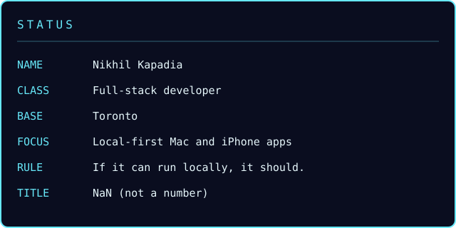

<div align="center">



[LinkedIn](https://www.linkedin.com/in/nikhilkapadia-/) · [X](https://x.com/NikhilKapadia_) · [Email](mailto:nikhil.kapadia.97@gmail.com)

</div>

I build local-first Mac apps. Most run with no account and no server. The ones that need a server say so.

Most ship under [Talix](https://talix.app), my one-person studio. The code lives at [dev-talix](https://github.com/dev-talix).

### Apps

- [Flo](https://flo.talix.app) is push-to-talk dictation that runs on the Mac. Hold a key, speak, and it types into whatever app has focus. Audio never touches the network.
- [Kleio](https://kleio.talix.app) is a meeting recorder with local transcription, speaker review, and optional screen recording.
- [Conductor](https://conductor.talix.app) controls your Mac with hand gestures from the webcam. Camera frames never leave the machine.
- [Rivals](https://joinrivals.app) is for iPhone and Apple Watch. Race your friends live, wherever they are. Everyone starts at the same moment on their own streets and sees each other's pace and gap in real time.
- [Podium](https://github.com/NikAtNight/now-app) is a todo app for iPhone and Mac. It shows only the 3 things to do next, ranked by deadline and priority.
- [PhotoVault](https://github.com/NikAtNight/photovault) is a password-locked, encrypted local photo and video library.
- [PulseDeck](https://pulsedeck.talix.app) is a menu bar monitor for dev machines. It shows CPU, memory, ports, per-process energy, and which coding agents are running.
- [File Cleanup](https://github.com/NikAtNight/file-cleanup) clears the screenshots I take while building apps. It has folder rules, daily schedules, and a preview before cleanup.

### Web products

- [OpenTab](https://opentab.talix.app) is time tracking and invoicing for agencies and studios, with a desktop timer.
- [ClipShare](https://clips.talix.app) is private video sharing from the menu bar. Drop a clip, get a link, and watch it in any browser. It is the one with a server, because sharing needs one.
- [Stubs](https://stubs.talix.app) turns a `.env` file into a link that opens once. Values are encrypted before they leave your machine.

### Developer tools

- [PatchDeck](https://patchdeck.talix.app) is a local-first desktop workbench for reviewing Git branches and directing AI agents.
- [pi-extensions](https://github.com/NikAtNight/pi-extensions) holds my extensions for the pi coding agent.

More, including older work, is at [nikhilkapadia.pages.dev](https://nikhilkapadia.pages.dev).

### Why `NaN`?

`Not a Number` · `NikAtNight` · a couple more meanings that are just for me.

### Toolbox

Swift and Rust for the apps, TypeScript and React for the web, three.js when a site needs stars, and on-device ML wherever a server used to be.

<div align="center">

```js
const nik = NaN  // reliably not a number
```

</div>
